# Wikipedia Through Time

**Is every Wikipedia telling the same story, and was it always?**

Junction 2026 · MariaDB challenge *Wikipedia Through Time* · **both tracks** (RAG + system-versioned tables)

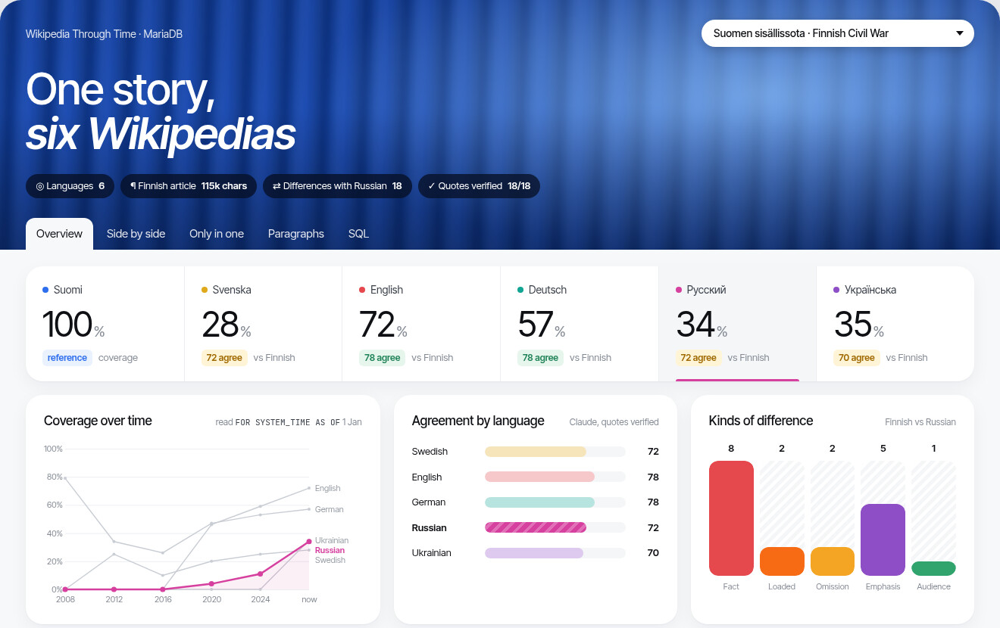

Wikipedia keeps every version of every article in every language, but you cannot compare the languages or
search the past. We put both into MariaDB **system-versioned tables**, with every version stored at its
**real Wikipedia save time** and its meaning as **bge-m3 vectors**:

- the full edit history of Finnish Wikipedia's *History of Finland* articles: **862,076 versions of 19,742
  articles (Feb 2003 – 1 Oct 2026), each with its full wikitext**, plus a vector of every article as it
  stood on each 1 January;
- every paragraph of nine Finnish-history articles in **six languages** (fi, sv, en, de, ru, uk), from 2008
  to today.

One idea runs through everything: time travel and vector search in the same SQL statement.

```sql
SELECT page_id, title, rev_id
FROM article_vector_history FOR SYSTEM_TIME AS OF TIMESTAMP '2015-01-01'
ORDER BY VEC_DISTANCE_COSINE(embedding, @q) LIMIT 10;   -- semantic search over Wikipedia as it stood then
```

On top of that: **Kielipeili** (how much of the Finnish story each language tells, and where it tells it
differently), **Ask Wikipedia in any year** (cited answers drawn only from the articles as they read on
that date), and **14 tools** for readers and editors, all on one hub page.

> **Live demo:** `<DEMO URL — to be added>` · **Video:** `<VIDEO URL — to be added>`

---

## What it does

### Kielipeili: one story, six Wikipedias

The MariaDB host's top pick: score each language version against a reference, and tell legitimate audience
differences apart from the same thing told differently. Nine showcase articles (the Winter War, the
Continuation War, the Civil War, the Mainila shots, Mannerheim, the Lapland War, Finlandisation, Kekkonen,
Molotov–Ribbentrop) in six languages, current versions plus those of 2008, 2012, 2016, 2020 and 2024.

1. **Coverage (MariaDB):** every paragraph is a bge-m3 vector in a system-versioned table. For each Finnish
   paragraph `AS OF` a moment, the nearest paragraph in the other language `AS OF` the same moment; coverage
   is the share of the Finnish text whose best match has cosine ≥ 0.60. One statement per language; re-run
   `AS OF` 1 January of 2008, 2012, 2016, 2020 and 2024, and now, it draws coverage over time.
2. **Agreement and differences (Claude):** for each language pair, conflicting facts, and framing labelled
   *audience* (legitimate: other readers need other context), *emphasis*, *loaded* or *omission*. Every
   quote is checked as an exact substring of the stored text.

**Example: the Finnish Civil War** (*Suomen sisällissota*; Finnish article 115k characters = 100, the
reference). Coverage: Swedish 28%, English 72%, German 57%, Russian 34%, Ukrainian 35%; Claude's agreement
with the Finnish version 72 / 78 / 78 / 72 / 70. Finnish vs Russian: 18 differences (fact 8, loaded 2,
omission 2, emphasis 5, audience 1), 18/18 quotes verified. The Russian article follows the Finnish one
closely on terror, prison camps and courts, but leaves out almost all of the long-term social and political
causes, puts more weight on outside actors and calls the Red rising a coup. One factual difference: the
Finnish article lists France among the first states to recognise Finland; the Russian one says France
refused. ([charts and summary](docs/media/kielipeili-fi-vs-ru.jpg) · [the France difference](docs/media/kielipeili-fact-france.jpg) ·
[how it is built](#kielipeili-one-story-six-wikipedias-webkielipeilihtml))

### Ask Wikipedia, in any year (RAG + system versioning)

The challenge's own question: "what did Wikipedia say about this in 2015, and what has changed since?" Ask
in Finnish, Swedish or English and pick a year.

1. **Retrieval:** `FOR SYSTEM_TIME AS OF` plus vector search over the yearly snapshot vectors, plus
   cross-language topic matching through Wikidata ids (an English question still reaches the Finnish article).
2. **Sources:** the article texts *as they read on that date*.
3. **Answer:** Claude Opus 5.5 answers only from those texts using the Citations API. Every claim links to the
   exact historical version (`https://fi.wikipedia.org/?oldid=<rev_id>`).
4. **"…and what changed since"** puts the answer from then next to the answer from now.

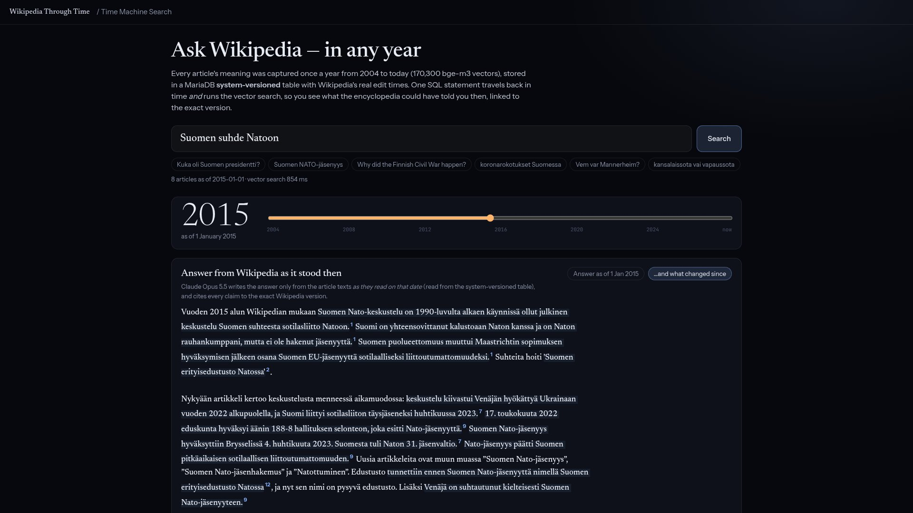

**Example: "Finland and NATO".** As of 1 Jan 2015, the answer cites the NATO-*debate* article: Finland is a NATO
partner that has not applied, and support stood at 26% in Aug 2014. Asked about today, it cites membership from
4 April 2023 and 79% support (June 2022). A warm answer takes 9–11 s and streams in as it is written.
([full-page screenshot with all 14 cited sources and the "how the answer drifted" chart](docs/media/02b-ask-nato-2015-compare-full.jpg))

### 14 tools on one hub

The supporting evidence: each tool reads the same history and shows one finding from it.

| Tool (page) | What it shows | What we found |
|---|---|---|
| [Time Machine Search](docs/media/02-ask-nato-2015-compare.jpg) (`timesearch.html`) | Semantic search over Wikipedia as it stood on any 1 January, 2004 → now, plus *Ask* | Answers drift: the "Finland and NATO" example above |
| [Knowledge Galaxy 3D](docs/media/03-galaxy-2007-jokela.jpg) (`galaxy.html`) | 29,460 articles placed by meaning; replay 2003 → 2026, stars flare when edited | 2007's brightest flare is the Jokela school shooting article |
| [Seismograph](docs/media/05-seismograph.jpg) (`seismograph.html`) | Edits per week; breaking news shows up as quakes | Jokela, Nov 2007: 826 edits in a month · COVID, Mar 2020: 453 · Turku attack, Aug 2017: 438 |
| [Knowledge Strata](docs/media/06-strata-talvisota.jpg) (`strata.html`) | An article's text as layers, coloured by the year each sentence was written | *Talvisota* (Winter War): 26% of today's 71,851 characters were written in 2006 |
| [Typewriter](docs/media/07-typewriter-talvisota.jpg) (`typewriter.html`) | An article's lead replayed version by version, with a word-level diff | *Talvisota*: 2,143 versions, 742 editors, 328 reverts; 214 edits changed the lead |
| [Edit Wars](docs/media/08-editwars.jpg) (`editwars.html`) | Who undoes whom, as a revert network | 45,626 reverts, but only 1,305 true wars between registered editors; the fiercest: *Axel Olof Freudenthal*, July 2006 |
| [Immune System](docs/media/09-immune.jpg) (`immune.html`) | How long vandalism survives | 55,222 reverted versions, half gone within about 14 minutes; median lifetime 4 min in 2008 vs 1.2 h in 2026 |
| [The Authors](docs/media/10-authors.jpg) (`authors.html`) | Editor generations, anonymous editors and bots | Class of 2007: 1,336 first-time editors; peak 463 active/month (Jan 2007); anonymous edits 31% (2004) → 12% (2026); bots 24% of edits in 2024; a bot saved the latest version of 37% of articles |
| [Heartbeat](docs/media/11-heartbeat.jpg) (`heartbeat.html`) | Every edit on the calendar and the clock | Busiest day (Helsinki time): 13 Nov 2024, 2,033 edits, 1,974 of them by Ipr1Bot fixing ISBN tags |
| [Three Wikipedias](docs/media/12-three-wikipedias.jpg) (`polyglot.html`) | fi / sv / en coverage and divergence by vector distance | 62% of 19,285 topics exist only in Finnish; 2,919 exist in all three; median fi–en vector distance 0.23 |
| [Growing Tree](docs/media/13-growing-tree.jpg) (`growth.html`) | The *Suomen historia* category tree as a growing sunburst | 59 KB in 55 articles at the end of 2003 → 134 MB in 19,742 today |
| [Biggest Stories](docs/media/14-biggest-stories-2021.jpg) (`race.html`) | Bar chart race of the largest and most-edited articles | *Suomen sisällissota* (Finnish Civil War) was the largest for 15 years 7 months, until the COVID timeline overtook it in April 2021 |
| [Link Web 3D](docs/media/15-linkweb.jpg) (`linkweb.html`) | Every wikilink between the articles, re-read at six moments | 2,387 links between 1,122 articles in 2006 → 86,280 links among 17,374 today |
| [Time Grep](docs/media/16-timegrep-105-paivaa.jpg) (`timegrep.html`) | grep through every version: when a phrase appeared, who removed it, how it was reworded | "105 päivää" (105 days) was first written into *Talvisota* by Peltimikko on 6 Dec 2009 and appears in 958 versions since |

Deep links that open straight onto a finding: `timesearch.html?q=Suomen%20suhde%20Natoon&y=2015&ask=cmp`,
`galaxy.html?year=2007.92`, `galaxy.html#fi:1256` (*Talvisota*), `race.html?t=202104`.

<details>
<summary><b>Screenshots</b></summary>

| | |
|---|---|
| 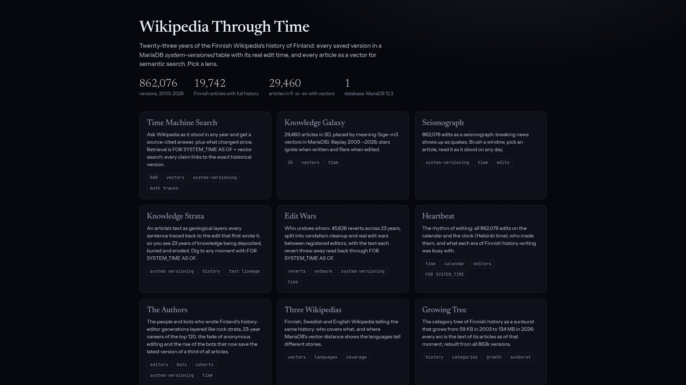 Hub | 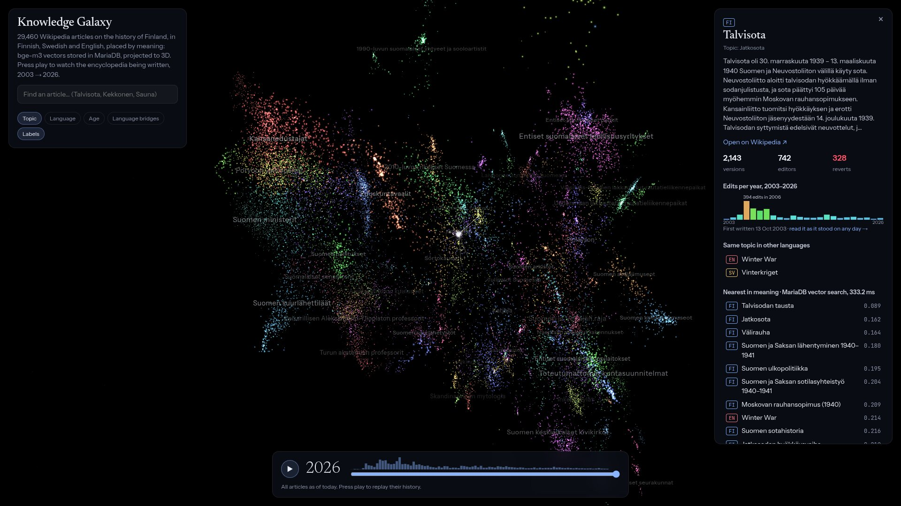 Galaxy: *Talvisota* and its nearest articles by meaning |
| 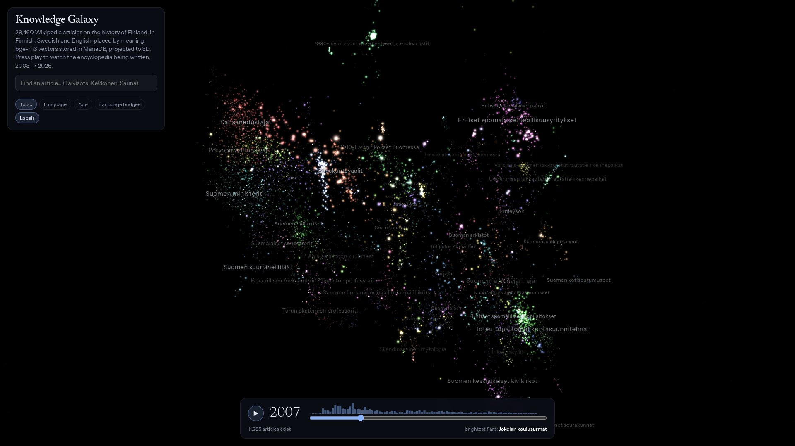 Galaxy, late 2007 | 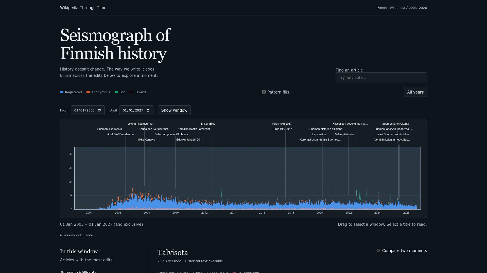 Seismograph |
| 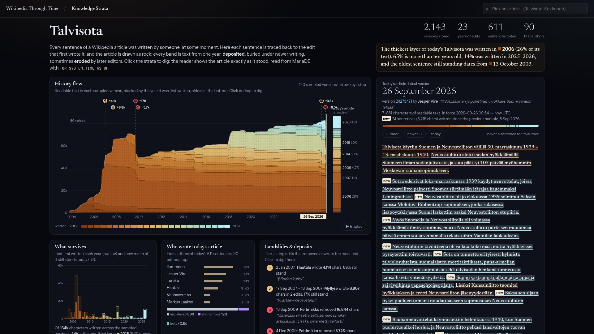 Knowledge Strata | 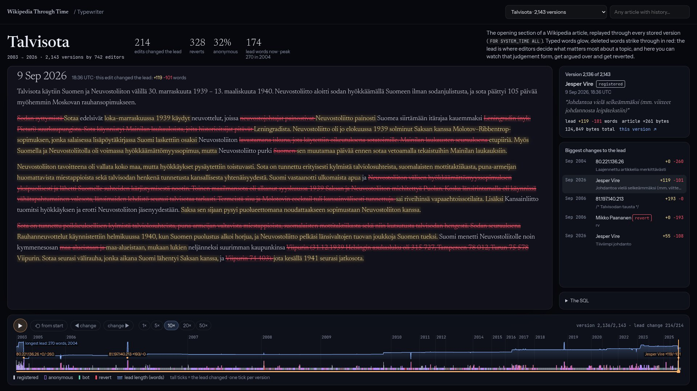 Typewriter |
| 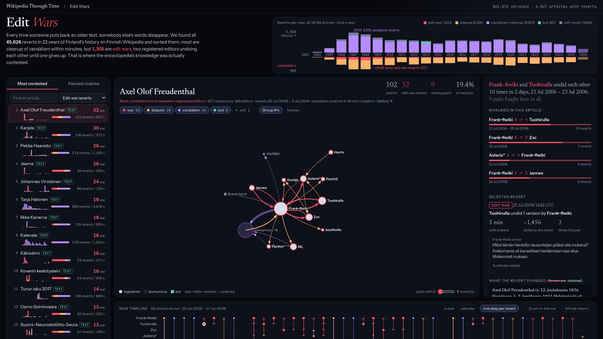 Edit Wars | 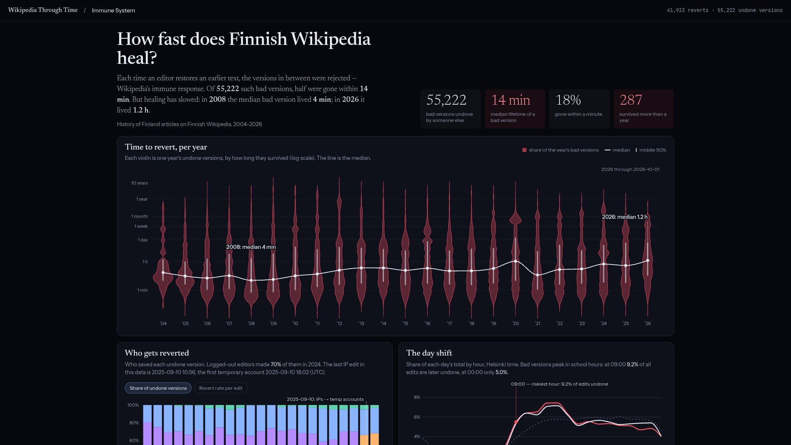 Immune System |
| 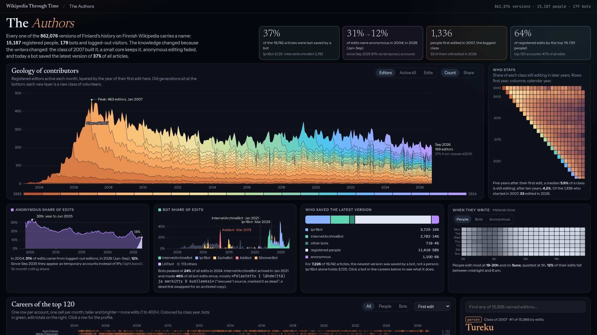 The Authors | 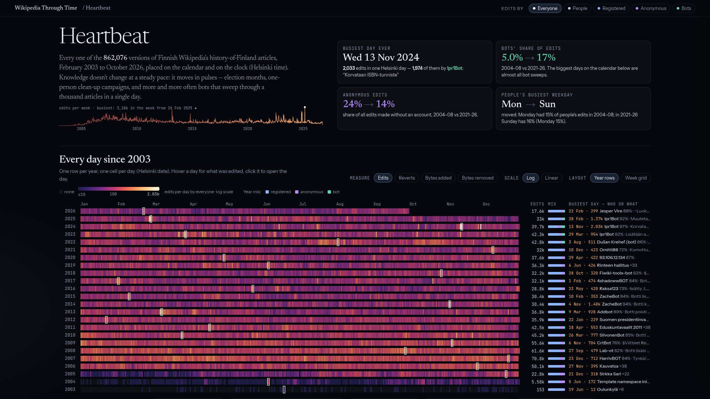 Heartbeat |
| 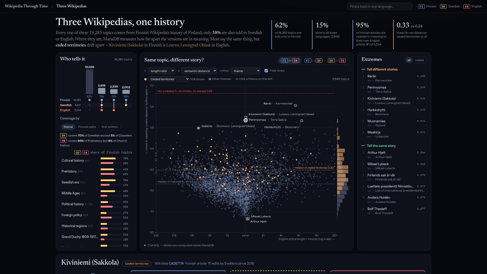 Three Wikipedias | 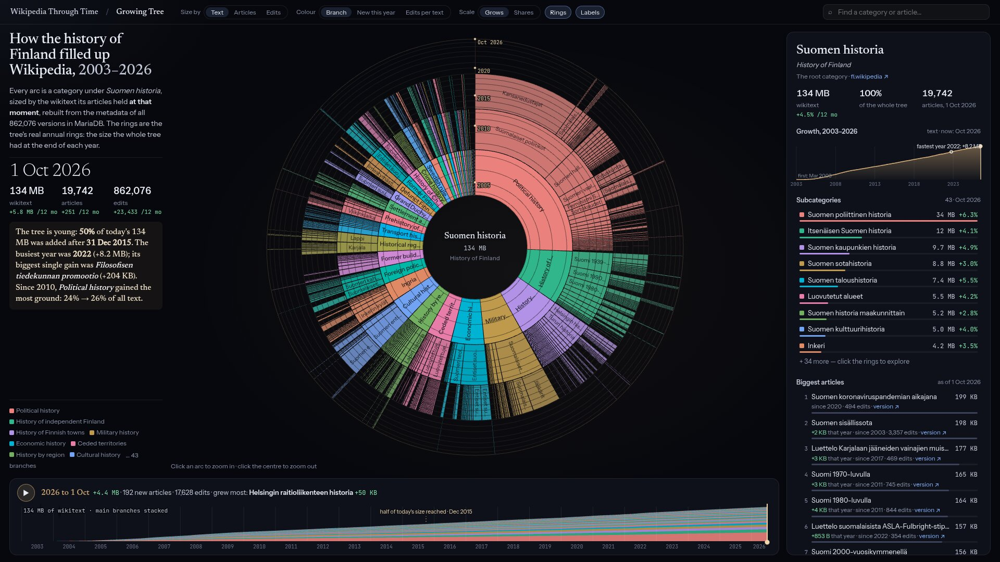 Growing Tree |
| 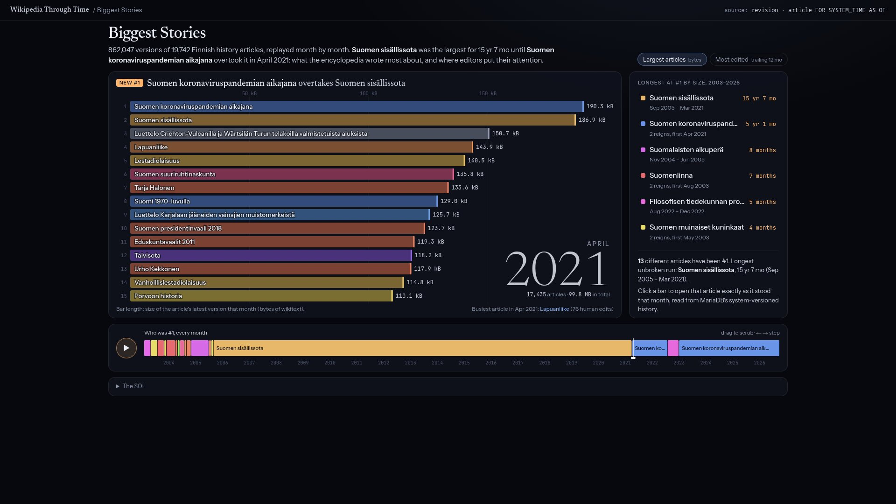 Biggest Stories, April 2021 | 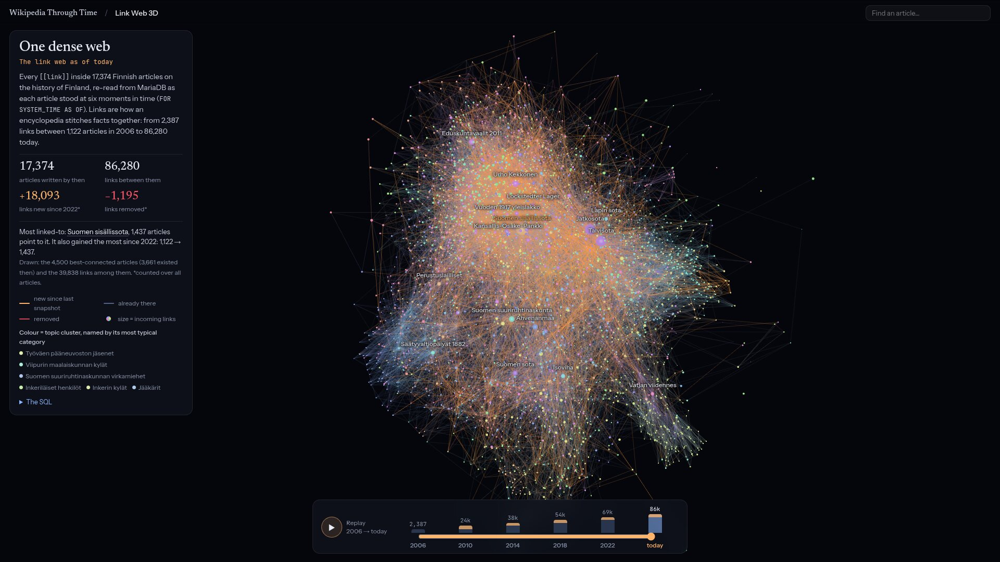 Link Web 3D |
| 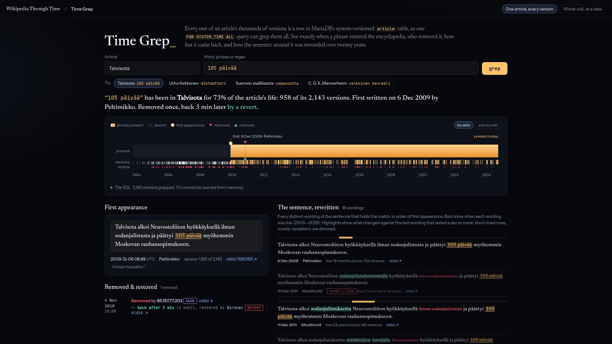 Time Grep | 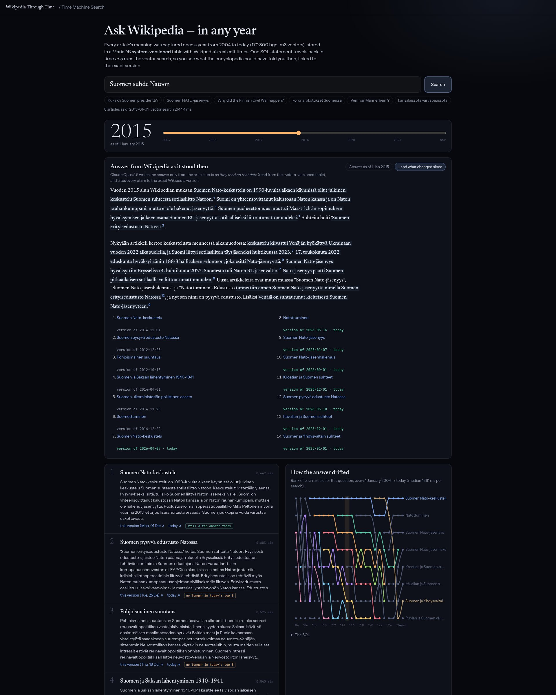 Ask, full page |

</details>

---

## Kielipeili / Language Mirror (`web/kielipeili.html`)

Any article, its longest language editions, scored against the **consensus of all editions** (no language is ground truth):
index = 0.5 × coverage (share of consensus facts told; a consensus fact is a paragraph group told by ≥ 3 editions,
matched by mutual nearest-neighbour bge-m3 vectors in MariaDB) + 0.3 × agreement (where editions disagree, does the
edition's own cited source back its claim, else does it side with the larger group; near-copies vote once) + 0.2 ×
sourcing (share of text in cited paragraphs). Claude lists the disagreements with exact quotes (checked); the cited web
sources are fetched and judged supports / contradicts / silent. Type a title or a Wikipedia URL on the page to load any
article; editions that are translations of a longer one (≥ half the text at cosine ≥ 0.8) do not take a slot.

**Context.dev** (`CONTEXT_DEV_API_KEY` in the service environment, never committed) drives the source check:
`POST /v1/web/scrape` renders every cited web source in a real browser (JavaScript pages, archives, most bot walls) so its
text can be checked, and `POST /v1/web/answers` (fast, JSON schema) researches each disagreement on the live web for
independent sources, Wikipedia and its mirrors excluded. Claude weighs the cited and the independent sources per edition;
"✓ web sources agree / ✗ disagree" on the page and the agreement score come from that.

### The original version (nine articles, Finnish reference)

The MariaDB host's top pick (see `context/`): compare language versions of the same article, with a score
per language and the differences shown side by side. Nine showcase articles (Talvisota, Jatkosota,
Suomen sisällissota, Mainilan laukaukset, Mannerheim, Lapin sota, Suomettuminen, Kekkonen,
Molotov–Ribbentrop) in fi, sv, en, de, ru and uk, current versions plus snapshots from 2008, 2012, 2016, 2020 and 2024.

- `lens_chunk`: every paragraph of every version, bge-m3 vector, **SYSTEM VERSIONED** with Wikipedia's
  real save times and a **VECTOR INDEX**. Coverage of the Finnish story by language X at time T is one
  statement (`app/kielipeili.py: SCORE_SQL`): for each Finnish paragraph `AS OF T`, the nearest X paragraph `AS OF T`.
- Aligned pairs are mutual nearest neighbours (cosine ≥ 0.55). Coverage counts Finnish text whose best match is ≥ 0.60.
- `lens_analysis`: Claude's review of each language pair (conflicting facts; framing labelled audience,
  emphasis, loaded or omission). Every quote is checked as an exact substring of the stored text.

```bash
uv run python -m scripts.lens_fetch                          # Wikipedia history pages + action=raw (the API rate-limits)
.venv-embed/bin/python -m scripts.lens_build                 # chunk + bge-m3 (CPU ok: ~3 chunks/s; GPU much faster)
uv run python -m scripts.lens_analyze                        # Claude via the `claude` CLI, 6 in parallel
uv run python -m scripts.lens_pairs                          # every language vs every other, per snapshot year -> lens_pair
uv run python -m scripts.lens_consensus "uk:Степан Бандера" "https://et.wikipedia.org/wiki/Harald_Nugiseks"   # consensus scores, conflicts, source checks (+ load articles)
.venv-embed/bin/python -m scripts.lens_embedsrv --port 8766  # bge-m3 service for on-demand loading from the page
uv run python -m scripts.lens_analyze --ref ru --lang uk     # Claude review with another reference language (Russian vs Ukrainian)
```
`.venv-embed`: `uv venv --python 3.12 .venv-embed && uv pip install --python .venv-embed/bin/python torch
--index-url https://download.pytorch.org/whl/cpu && uv pip install --python .venv-embed/bin/python sentence-transformers pymysql numpy`.

## Framing check with NVIDIA Nemotron (`web/framing.html`)

Pick an article and two editions (for example Finnish and Russian) and a date. MariaDB aligns the paragraphs that tell
the same part of the story as both stood then (`app/kielipeili.py: alignment`, mutual nearest neighbours under
`FOR SYSTEM_TIME AS OF`). The 3 to 6 shared pairs that are told most differently (lowest cosine) go to **NVIDIA
Nemotron 3.5 Super VL** (`nvidia/nemotron-3.5-super-vl-120b-a12b`, NVIDIA Build API), which labels each pair (none,
fact, emphasis, loaded, omission, audience), explains it and quotes the decisive words from both revisions. Every
quote is checked as an exact substring of the stored paragraph; failed quotes go back to the model once with the
paragraph to copy from, and what still fails is not shown as evidence. The page shows the engine, both revision
links (`?oldid=`), and the quote check before and after the repair round.

- `app/nemotron.py`: `/api/nemotron/status`, `/api/nemotron/frame?topic=&lang=&ref=&at=&n=&engine=nemotron|claude`.
  Nemotron is the default when `NVIDIA_API_KEY` is set; otherwise Claude. Retries 429/5xx with backoff, 60 s
  timeout, caches by input hash, 1 to 3 model calls per click.
- Smoke test with a key, no database: `NVIDIA_API_KEY=nvapi-... uv run python -m scripts.nemotron_smoke`.
- Optional: `NEMOTRON_BASE_URL`, `NEMOTRON_MODEL` (see `.env.example`).

## How MariaDB does the heavy lifting

Everything runs in one MariaDB 12.3.3 database (`wikitime`): there is no separate vector store and no
separate history store.

| Table | Rows | What |
|---|---|---|
| `article` | 862,076 versions | **System-versioned.** Full wikitext of every version of all 19,742 Finnish articles, each stored at its real Wikipedia edit time. `FOR SYSTEM_TIME AS OF '2015-06-01'` returns what Wikipedia said that day. |
| `article_vector_history` | 170,300 | **System-versioned.** One bge-m3 vector (`VECTOR(1024)`) per article for each 1 January 2004–2026, plus the latest version; `row_start` is that version's real save time. |
| `revision` | 862,076 | Metadata of every version: time, user, anonymous, bytes, delta, `is_revert`, edit summary. |
| `current_article` | 29,460 | Current text in fi / sv / en (fi 19,285 · sv 4,921 · en 5,254), with Wikidata ids and `FULLTEXT(title, text)`. |
| `article_vector` | 29,460 | bge-m3 `VECTOR(1024)` per current article, `VECTOR INDEX` (M=16, cosine). Works across languages. |
| `category_link`, `article_category` | 1,760 · 39,619 | The category tree under *Luokka:Suomen historia*. |

**1. Real edit times become system time.** With `SET system_versioning_insert_history = 1`
([`scripts/load_m.py`](scripts/load_m.py)) each version is inserted with `row_start` = when it was saved on
Wikipedia and `row_end` = when the next version replaced it. So `AS OF` means "what a reader saw that day":

```sql
SELECT rev_id, user, LEFT(text, 500) FROM article
FOR SYSTEM_TIME AS OF TIMESTAMP '2015-06-01 00:00:00' WHERE page_id = 1256;   -- Talvisota on 1 June 2015
```

Strata, Typewriter, Time Grep, Link Web, Edit Wars and the Ask sources all read text this way, either
`AS OF` a moment or `FOR SYSTEM_TIME ALL` for every version of an article.

**2. Time travel and vector search in one statement.** `article_vector_history` is system-versioned too,
so the time filter and the vector search run in the same statement
([`app/timesearch.py`](app/timesearch.py)):

```sql
SELECT page_id, title, rev_id, row_start, distance
FROM (SELECT page_id, title, rev_id, row_start, VEC_DISTANCE_COSINE(embedding, @q) AS distance
      FROM article_vector_history FOR SYSTEM_TIME AS OF TIMESTAMP '2015-01-01' IGNORE INDEX (embedding)
      ORDER BY distance LIMIT 10) s
ORDER BY distance;
```

**3. Window functions find reverts and edit wars** ([`app/editwars.py`](app/editwars.py),
[`scripts/build_immune.py`](scripts/build_immune.py)). A revert is a version whose text hash matches an earlier version
that is not the previous one; every version in between was undone:

```sql
SELECT page_id, rev_id, ts, user,
       ROW_NUMBER() OVER (PARTITION BY page_id ORDER BY ts, rev_id)       AS seq,
       LAG(rev_id)  OVER (PARTITION BY page_id, sha1 ORDER BY ts, rev_id) AS same_prev
FROM revision;   -- 862,076 versions -> who undid whom, and how long each bad version lived
```

**4. Cross-language comparison with `VEC_DISTANCE_COSINE`.** Three Wikipedias self-joins `current_article`
on `wikidata_id` and computes the vector distance between the fi, sv and en versions of each topic inside
MariaDB ([`scripts/build_polyglot.py`](scripts/build_polyglot.py)). Ask uses the same Wikidata join to match
topics across languages.

**5. The category tree.** The Growing Tree precompute ([`scripts/build_growth.py`](scripts/build_growth.py))
lays the tree out with a breadth-first search in Python over `category_link`, and takes each article's size
at each moment from `revision`. The same tree can be walked in SQL with a recursive CTE. We ran this query
for this README, and it returns 1,475 categories:

```sql
WITH RECURSIVE tree (cat) AS (
  SELECT CAST('Suomen historia' AS VARCHAR(255))
  UNION
  SELECT l.child FROM tree JOIN category_link l ON l.parent = tree.cat
)
SELECT COUNT(*) AS categories FROM tree;
```

Other MariaDB features we use: `REGEXP_REPLACE` inside `AS OF` reads (Link Web extracts wikilinks in the
server, so only the link targets cross the network), `REGEXP_INSTR` over `FOR SYSTEM_TIME ALL` (Time Grep), and
`FULLTEXT` with `MATCH … AGAINST` (Time Grep's whole-wiki search narrows the candidates before its `AS OF` reads).

---

## What we found (for the MariaDB team)

**A `VECTOR INDEX` works on a system-versioned table, but its recall drops sharply under `FOR SYSTEM_TIME AS
OF`.** A single HNSW graph covers every history row, and only 1–12% of rows are valid at any one
moment (2,193 rows on 1 Jan 2006, 19,742 today), so most candidates are filtered out after the graph search. Measured with
[`scripts/bench_asof_vector.py`](scripts/bench_asof_vector.py) (5 questions × 5 dates, 2006–2026, k = 10):

| Search | recall@10 | Notes |
|---|---|---|
| Exact (`IGNORE INDEX (embedding)`) | **1.00** | ~115 ms on the server over all 170,300 vectors |
| HNSW, default `mhnsw_ef_search` | 0.47 | can return the **same row twice** |
| HNSW, `mhnsw_ef_search` = 100 | 0.74 | |
| HNSW, `mhnsw_ef_search` = 400 | 0.84 | |
| HNSW, `mhnsw_ef_search` = 1000 | 0.91 | |
| HNSW, `mhnsw_ef_search` = 4000 | 0.98 | multi-second outliers |

Time-travel search therefore uses exact search. A minimal repro with the duplicate rows, and results that
change with `LIMIT` in ways that are not prefixes of each other, is in
[`docs/mariadb-vector-svt-duplicates.md`](docs/mariadb-vector-svt-duplicates.md). A period-aware vector index,
or one graph per history partition with `PARTITION BY SYSTEM_TIME`, would let this scale (a partitioned table
cannot carry a vector index yet: [MDEV-35315](https://jira.mariadb.org/browse/MDEV-35315)).

**`system_versioning_insert_history` makes historical data a first-class time machine.** Loading Wikipedia's
real edit times as `row_start` means every `AS OF` query answers "what did Wikipedia say then", with no
separate valid-time columns or hand-written range joins.

**One embedding model for both tables.** We embedded the 170,300 snapshot vectors with bge-m3 on an RTX 5090
in 14 minutes. Our bge-m3 reproduces the vectors shipped in MariaDB Foundation's dataset (mean cosine
1.0000), so a question embedded by our query server can be compared with both the dataset's current vectors
and our historical ones.

---

## Run it

You need [uv](https://docs.astral.sh/uv/), podman or docker with compose, and the `gh` CLI. You need a CUDA GPU
only to rebuild the snapshot vectors. Ask needs Claude credentials (`ANTHROPIC_API_KEY`, or a profile from
`ant auth login`).

**Where it runs.** The full history is too large for a laptop. For the hackathon, MariaDB 12.3.3 (datadir on
an HDD), the app and the query embedder run as Slurm jobs on a team GPU/compute box
(`scripts/chili_db.sh`, `scripts/chili_services.sh`; the GPU embedding job is `scripts/chili_embed.sh`).
Laptops reach the database through an ssh tunnel on `127.0.0.1:3310` (`scripts/db_tunnel.sh`). Every script
reads `DB_HOST` / `DB_PORT` / `DB_USER` / `DB_PASSWORD` / `DB_NAME`, which default to
`127.0.0.1:3310`, `wikitime`. The steps below work the same against a local database.

### 1. MariaDB

```bash
podman compose --profile local up -d   # mariadb:lts on 127.0.0.1:3310, db/user/password "wikitime"
                                       # (VECTOR needs MariaDB >= 11.7; we run 12.3.3)
uv sync
```

### 2. Data (MariaDB Foundation's Wikipedia datasets, S and M, ~450 MB, checked against SHA256SUMS)

```bash
mkdir -p data/s data/m
(cd data/s && gh release download s-2026-10 -R MariaDB/mariadb-wikipedia-datasets && sha256sum -c SHA256SUMS)
(cd data/m && gh release download m-2026-10 -R MariaDB/mariadb-wikipedia-datasets && sha256sum -c SHA256SUMS)
mkdir -p data/lists && curl -sL https://raw.githubusercontent.com/MariaDB/mariadb-system-versioning-wikipedia/main/data/articles.tsv > data/lists/reference50.tsv
```

### 3. Load

```bash
uv run python -m scripts.create_tables
uv run python -m scripts.load_s                              # ~2.5 min: 29,460 articles fi/sv/en + bge-m3 vectors + categories
uv run python -m scripts.load_m                              # `revision` for all 862k versions + text for a default subset
uv run python -m scripts.load_m --max-mb 100000 --skip-meta  # text of every version of every article (what we run; resumable)
```

The default `load_m` loads text only for articles whose whole history is under 0.5 MB of wikitext, plus the
reference demo's 50 famous articles, so it fits on a small disk. The second command, also in
`scripts/chili_load_full.sh`, loads the full history.

### 4. Time-travel vectors (GPU)

```bash
bash scripts/chili_embed.sh                      # creates .venv-gpu (torch cu128 + sentence-transformers), then
                                                 # scripts/embed_snapshots.py -> data/timesearch/snapshots.parquet
uv run python -m scripts.load_timesearch         # -> article_vector_history (system-versioned, real save times)
uv run python -m scripts.build_snapshot_text     # cleaned snapshot texts for Ask (one key read per source)
```

### 5. Precompute the views (each is idempotent)

```bash
for s in editwars immune authors heartbeat polyglot growth race linkweb typewriter strata timegrep; do
  nice uv run python -m scripts.build_$s
done
uv run --with umap-learn python -m scripts.project_3d   # 3D layout + clusters of the 29,460 vectors
uv run python -m scripts.build_galaxy                   # -> galaxy_point + web/data/galaxy.json
```

### 6. Query embedder and app

```bash
.venv-gpu/bin/python -m scripts.embed_server --port 8765 --device cpu   # bge-m3 for questions; app reads EMBED_URL
uv run python -m app.server                                             # dev server: http://localhost:8000
uv run gunicorn -w 3 --threads 8 --timeout 120 -b 127.0.0.1:8106 app.server:app   # as served for the demo
```

Each `app/<name>.py` blueprint is mounted at `/api/<name>/`. Each `web/<name>.html` with a `demo-title` meta
tag is listed on the hub. The pages are plain HTML + ES modules (d3@7.9.0, three@0.170.0 from a CDN), with no
build step.

Fast tests (no database needed): `uv run python -m unittest discover -s tests`

SQL shell on the local database: `podman exec -it wikitime-db-local mariadb -uwikitime -pwikitime wikitime`

---

## Stack

MariaDB 12.3.3 (system-versioned tables, `system_versioning_insert_history`, `VECTOR(1024)` + `VECTOR INDEX`,
`VEC_DISTANCE_COSINE`, window functions, `REGEXP_*`, `FULLTEXT`) · Python 3.13, Flask +
gunicorn, PyMySQL, DuckDB (precompute) · d3, three.js · bge-m3 via sentence-transformers (RTX 5090 for the
snapshot vectors) · Claude Opus 5.5 with the Citations API.

## Data & licence

- **Code:** MIT, see [LICENSE](LICENSE).
- **Wikipedia content:** the article text, and the vectors and excerpts derived from it, are under
  [CC BY-SA 4.0](https://creativecommons.org/licenses/by-sa/4.0/). Credit Wikipedia and its authors. Every
  row keeps its `page_id` / `rev_id`, so it links back to `https://fi.wikipedia.org/?curid=<page_id>` and
  `?oldid=<rev_id>`.
- **Datasets:** MariaDB Foundation's
  [mariadb-wikipedia-datasets](https://github.com/MariaDB/mariadb-wikipedia-datasets) (Finnish Wikipedia,
  *History of Finland*; releases `s-2026-10` and `m-2026-10`).
- **Reference repos** (MIT; cloned into `ref/` for reading, not redistributed):
  [mariadb-system-versioning-wikipedia](https://github.com/MariaDB/mariadb-system-versioning-wikipedia)
  (time-machine demo; its 50-article list, and parts of `wikitime/wikitext.py` are adapted from it),
  [mariadb-vector-wikipedia-rag](https://github.com/MariaDB/mariadb-vector-wikipedia-rag) (RAG demo),
  [robertsilen/junction2026](https://github.com/robertsilen/junction2026).

## Team

| Name | Role | Contact |
|---|---|---|
| `<NAME>` | `<ROLE>` | `<PHONE / DISCORD>` |
| `<NAME>` | `<ROLE>` | `<PHONE / DISCORD>` |
| `<NAME>` | `<ROLE>` | `<PHONE / DISCORD>` |
| `<NAME>` | `<ROLE>` | `<PHONE / DISCORD>` |
